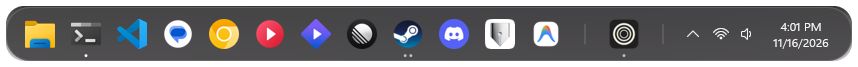

# Windock

[](https://github.com/jolleyDesign/windock/actions/workflows/ci.yml)
[](LICENSE)
[](https://buymeacoffee.com/jolley)

A clean, fast dock for Windows 10/11, in the spirit of the macOS Dock and GNOME's dash. Use it
beside the taskbar, or hide the taskbar and let Windock replace it.



- Pinned apps plus running apps, with indicators for open windows, the focused app and apps asking for attention
- Live window previews on hover, like the Windows taskbar
- macOS-style magnification (optional), frosted-glass background, light/dark theme that follows Windows
- Bottom, top, left or right edge, any monitor, optional auto-hide
- Can hide the Windows taskbar while it runs, and puts it back when it quits
- A clock and network, volume and battery icons, shown automatically when the taskbar is hidden:
  at the end of the dock, or in a small bar of their own in the screen corner
- Other apps' tray icons (OneDrive, Slack, VPN clients...) beside them, the ones Windows keeps off
  the taskbar behind an arrow
- A Start button and a Show desktop button, also shown automatically when the taskbar is hidden
- Drag icons to reorder, drag an icon off to remove it; drop files onto an app to open them with it, or between apps to pin them
- Keyboard shortcuts for pinned apps and for showing the dock
- A settings window, or a hot-reloaded TOML file if you prefer editing text
- Native Rust + Win32: uses no CPU when idle, ~30 MB of memory, one ~6 MB `.exe`, no runtime to install

## Installing

Windock runs on 64-bit Windows 10 and 11. Download `windock.exe` from the
[latest release](https://github.com/jolleyDesign/windock/releases/latest) (or
[build it from source](#building)), put it wherever you like, and run it. It keeps no state next to
the `.exe`, and needs no installer or admin rights.

The `.exe` isn't code-signed yet, so the first time you run it, Windows SmartScreen may say it
"protected your PC". Choose **More info** → **Run anyway**. Each release lists SHA-256 checksums if
you'd like to check your download.

- **Start at sign-in:** turn on *Start at sign-in* in the settings window (or `autostart = true`).
- **Quit:** right-click the dock beside the apps → **Quit Windock**. If it hid the taskbar, the
  taskbar comes back.
- **Uninstall:** turn off *Start at sign-in*, quit, then delete `windock.exe` and
  `%APPDATA%\Windock` (settings, log and copied taskbar shortcuts).

## Using it

| Action | Result |
| --- | --- |
| Click an app that isn't running | Launch it (the icon bounces until a window appears) |
| Click a running app | Bring its most recent window forward |
| Click the focused app | Minimize it (or cycle through its windows, if it has several) |
| Middle-click | Open a new window / instance |
| Hover a running app | Live previews of its windows: click one to switch to it, **✕** or middle-click to close it |
| Right-click an app | Pick a window (when there are several), Open / New window, Keep in dock / Remove from dock, and last, Close window(s) |
| Right-click the dock between or beside the apps | Show desktop, Import taskbar pins, Dock settings… (the settings window), Quit Windock (also under the clock's and status icons' entries) |
| Drag an icon along the dock | Reorder pinned apps |
| Drag an icon off the dock and release | Unpin it (the Start button: hide it, as `start_button = "never"` does) |
| Drop files onto an app | Open them with that app |
| Drop files, shortcuts or folders between apps | Pin them at that position (programs and shortcuts always pin) |
| Click the clock | Notifications and calendar (right-click: Adjust date and time) |
| Click the network/volume icons | Quick Settings, opened above them when they're in a bottom or side dock (right-click: sound, mixer, network and power settings) |
| Scroll over them / middle-click | Change the volume / mute |
| Click / right-click another app's tray icon | What it does on the taskbar: usually open the app / its menu |
| Click the arrow beside them | A grid of the tray icons Windows keeps off the taskbar; click or right-click them as usual (it stays open while an icon's menu is up) |
| Click the Start button | Open (or close) the Start menu; right-click for the Win+X menu |
| Click Show desktop | Minimize every window; click again to bring them back |
| Ctrl+Alt+1–9 (0 for the 10th) | Open or switch to that pinned app, like clicking it |
| Win+Shift+D | Show or hide the dock (with auto-hide: slide it in) |

## Configuration

Right-click the dock beside the apps (or the clock) → **Dock settings…** opens the settings window
(also `windock.exe --settings`). Every change shows up in the dock as you make it.

Behind it is `%APPDATA%\Windock\config.toml`, created on first run with every option commented.
You can edit it directly instead: changes apply as soon as you save, and if the file has an error,
the dock shows it and keeps the last good settings. The main options:

```toml
[dock]
position = "bottom"      # bottom | top | left | right
monitor = "primary"      # or 0, 1, ...
autohide = false
autohide_delay_ms = 400
reserve_space = false    # keep maximized windows from covering the dock
hide_taskbar = false     # hide the Windows taskbar, clock and tray icons included
always_on_top = true
show_running = true
show_all_desktops = false
show_labels = true
previews = true          # live window previews on hover
hide_on_fullscreen = true
click_minimizes = true
autostart = false        # start at sign-in
gpu = false              # GPU rendering: ~40 MB more RAM; software is plenty for a dock
start_button = "auto"    # auto (while the taskbar is hidden) | always | never
show_desktop = "auto"    # auto | always | never

[appearance]
theme = "auto"           # auto | dark | light
icon_size = 48
spacing = 6
padding_x = 8            # left and right of the icons
padding_y = 8            # above and below the icons
edge_margin = 8
corner_radius = 18
blur = true
indicator = "dot"        # dot | line | none
label_font = "Segoe UI Variable Text"
label_size = 13
# background = "#1c1c1e8c" (and border, indicator_color, active_indicator_color,
# attention_color, label_background, label_text): "#RRGGBB" or "#RRGGBBAA"

[magnification]
enabled = true
scale = 1.6
range = 3.0

[animation]
enabled = true
speed = 1.0
bounce_on_launch = true

[shortcuts]
open_app = "ctrl+alt"    # + 1-9 opens pinned app N; "" turns it off ("win+ctrl+alt" on AltGr keyboards)
toggle_dock = "win+shift+d"

[clock]
show = "auto"            # auto (while the taskbar is hidden) | always | never
time = ""                # "" follows Windows; or a pattern like "HH:mm" or "h:mm tt"
seconds = false
date = "short"           # none | short | long, or a pattern like "ddd d MMM"
size = 12
# color = "#f5f5f7"

[tray]                   # status icons beside the clock
placement = "dock"       # clock and status icons: dock | corner | hidden
show = "auto"            # auto | always | never
network = true
volume = true
battery = true           # only on devices with a battery
apps = "promoted"        # other apps' icons: promoted (as the taskbar shows them) | all | none
icon_size = 16
spacing = 12             # between these icons and the clock; [appearance] spacing is for apps

[[pinned]]
path = 'C:\Windows\explorer.exe'          # .exe, .lnk, folder, or
name = "File Explorer"                    # 'shell:AppsFolder\<AppUserModelID>' for Store apps
# args = "..."  working_dir = "..."  (optional; %ENV_VARS% are expanded)
```

To find a Store app's ID, run `Get-StartApps` in PowerShell.

The log is at `%APPDATA%\Windock\windock.log`.

## Known limitations

- Apps that ignore `TaskbarCreated` (OneDrive does) only show their tray icon once they next update
  it, or after a restart of the app.
- Balloon notifications from tray icons are left to Windows.
- No jump lists, progress bars or unread badges yet, and one dock on one monitor.
  [PLAN.md](PLAN.md) has the roadmap.

## Building

The build cross-compiles from WSL (or Linux) using [`cargo-xwin`](https://github.com/rust-cross/cargo-xwin):

```sh
rustup target add x86_64-pc-windows-msvc
cargo install cargo-xwin --locked
scripts/deploy.sh          # build, install to %LOCALAPPDATA%\Programs\Windock, (re)start
scripts/deploy.sh --stop   # stop the running dock
```

On Windows itself, `cargo build --release` works with the MSVC toolchain, and
`cargo run --release` starts the dock straight from the build.

Run the tests in release mode (`cargo test --release` on Windows): in debug builds, three of the
settings window's raster tests trip a debug assertion inside egui. From WSL, `cargo xwin test` tries to
run them under Wine, so build with `--no-run` and run the printed `.exe` on Windows.
[CONTRIBUTING.md](CONTRIBUTING.md) has more.

## How it works

| File | Role |
| --- | --- |
| `src/app.rs` | The dock window: layout, magnification, input, drag & drop, auto-hide, animation loop |
| `src/app/preview.rs` | The hover popup with live DWM window thumbnails |
| `src/app/overflow.rs` | The grid of hidden tray icons that opens from the arrow |
| `src/app/menu.rs` | The right-click menu, drawn like the dock |
| `src/app/droptarget.rs` | Files dragged onto the dock: open with an app, or pin |
| `src/clock.rs` | The clock's text, formatted by Windows |
| `src/tray.rs` | Other apps' tray icons: a stand-in `Shell_TrayWnd` that keeps a copy and passes everything on to Explorer |
| `src/status.rs` | Volume, network and battery, watched through Core Audio, IP Helper, WLAN and power notifications |
| `src/hotkeys.rs` | Parsing shortcut strings like `win+shift+d` |
| `src/settings.rs` | The settings window (`windock.exe --settings`, egui) |
| `src/softgui.rs`, `src/softgui/raster.rs` | Hosts the settings window and draws it on the CPU, so it needs no GPU driver (~10 MB instead of ~170 MB) |
| `src/taskbar.rs` | Reads the taskbar's pinned apps for importing, and hides the taskbar |
| `src/logo.rs`, `build.rs` | The app icon, drawn in code and embedded at build time |
| `src/apps.rs` | Finds taskbar-worthy windows and groups them by AppUserModelID / executable |
| `src/render.rs` | A shared Direct2D device plus a composition surface per window, each with a host-backdrop (blur) visual |
| `src/icons.rs` | Loads high-resolution shell icons on a background thread |
| `src/config.rs` | TOML schema, theme palettes, comment-preserving saves of `[[pinned]]` |
| `src/shell.rs` | Launching, shortcuts, version info, registry, theme detection |

How the pieces fit:

- **Idle:** the UI thread sleeps in `GetMessage`.
- **Animating:** it renders once per display refresh, paced by `DwmFlush`, and redraws only the area that changed.
- **Window tracking:** WinEvent hooks and the shell hook report window changes, so there is no polling.
- **Click-through:** the window region tracks the visible dock, so the transparent parts pass clicks to whatever is below.

## Contributing

Bug reports, ideas and pull requests are welcome. [CONTRIBUTING.md](CONTRIBUTING.md) explains how
to build, test and send a change, and [PLAN.md](PLAN.md) lists what's being worked on. Please follow
the [Code of Conduct](CODE_OF_CONDUCT.md), and report security issues as [SECURITY.md](SECURITY.md)
describes rather than in a public issue.

## Support

Windock is free and always will be. If it's useful to you, you can
[buy me a coffee](https://buymeacoffee.com/jolley).

## License

[MIT](LICENSE)
